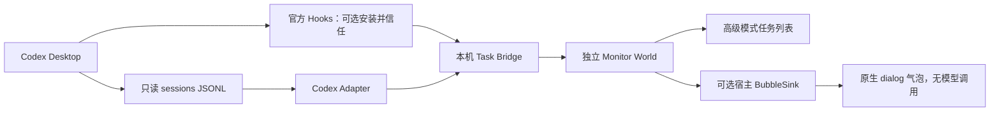

# 架构、接口与证据

## 调研版本

- Coopanion `12b221df159837bae71d1a12bfcf632457b659a0`，package.json 版本 0.2.8。
- Cortico 子模块 `ace4c640af07f21c15f81116c370fda0fe828389`，World API 6。
- 本机 Desktop rollout 元数据版本 `0.164.0-alpha.11.1`；较早当天会话为 `0.163.0-alpha.11.2`。这是运行时元数据版本，不冒充 Desktop 商店版本。
- 仓库：[Coopanion](https://github.com/Pal-AI-Lab/Coopanion/tree/12b221df159837bae71d1a12bfcf632457b659a0)。

## 上游问题的答案

1. `vendor/cortico/src/world.ts` 定义 `WorldDefinition`，默认导出；manifest 声明 `cortico.kind=world`、`api=6`。`loadExtensions()` 加载，Coopanion `core/companion.ts` 用 `withWorlds()` 装配。可从高级模式扩展页选择本机目录或 npm 包，不需要 Fork。
2. `WorldHost.pushEvent()` 可以主动投递事件。默认通往 Bot 的推理，不是 UI 通知总线。
3. `packages/cortico-world-desktop-pet/src/world.ts` 的 `pet_say` 是模型工具；公开实例方法 `dialog()` 可直接显示气泡，其说明明确 Nothing reaches the bot。
4. `WorldHost` 没有「调用另一个 World」或获取桌宠对象的方法。`docs/DEVELOPMENT.md` 明确应用壳不为第三方扩展提供普通界面入口。不能凭空编造 `ctx.pet.say()`。
5. 活动气泡由桌宠 `onRunPhase` 跟随 **Coo 自己** 的模型状态。复用它显示 Codex 会把两个不同 Agent 混为一谈。本 MVP 使用独立高级面板和完成气泡，不覆盖 Coo 的活动状态。
6. 无模型原生气泡采用宿主装配层注入 `BubbleSink`，无需修改 Cortico 或桌宠内部实现。当前 checkout 的改动只在 `core/companion.ts`；它等引导结束、桌宠连接且 Coo 空闲才显示，每条等待真实 dialog answer 后推进。

## Codex 官方接口与实机证据

[官方 Hooks 文档](https://learn.chatgpt.com/docs/hooks) 定义 UserPromptSubmit、PreToolUse、PostToolUse、PermissionRequest、Interrupt、Stop；带 Codex `turn_id`。插件形式见 [官方插件文档](https://developers.openai.com/plugins/build/plugins)。手工安装不等于信任 Hook，用户须在 Desktop 审查并信任定义。当前 Hook 是否在本机 GUI 触发必须按验收表测试，不能用 relay 单测代替。

官方 `Stop` 可被其他 Hook 请求继续，故映射 `unknown`，最终完成仍依赖明确 `task_complete`。本机 `config.toml` 未发现启用的 notify 配置；没有修改它，也没有证实 CLI notify 对当前 Desktop 生效。此项目不依赖 notify。

App-server 是供客户端建立并管理自己连接的协议；没有在当前环境发现可直接被第三方订阅所有现有 Desktop 任务的官方广播端点。因此不另起 app-server 冒充正在运行的 Desktop。没有接触内部数据库、认证文件或修改 Codex 程序文件。

实机只提取结构得到：

```json
{"type":"session_meta","payload":{"id":"<session>","originator":"Codex Desktop","source":"vscode","thread_source":"user"}}
{"type":"event_msg","timestamp":"<ISO>","payload":{"type":"task_started","turn_id":"<turn>"}}
{"type":"event_msg","timestamp":"<ISO>","payload":{"type":"task_complete","turn_id":"<turn>"}}
```

同一天记录存在后台 `guardian_review`，其 source 是对象；默认排除，避免把内部权限审核结束当成人类任务完成。未来 Desktop 格式变化可能需要更新过滤条件，诊断脚本会给出类型计数；未知格式不猜测。

| 统一事件 | 证据 | 当前支持 |
| --- | --- | --- |
| started | UserPromptSubmit / task_started | 已实现 |
| running | Pre/PostToolUse / item_completed / token_count | 已实现，最多约每 5 秒一条；表示观察到活动 |
| needs_attention | PermissionRequest | 已实现；GUI 触发待人工验证，不解析自然语言问句 |
| completed | task_complete，明确 turn_id | 已实现；真实历史格式及活动读取已验证 |
| cancelled | Interrupt / 带 turn_id 的 turn_aborted | 已实现，历史 Desktop 样本见到 turn_aborted；GUI Interrupt 待验证 |
| failed | 需要明确任务级失败事件 | 协议保留，当前不自动发送 |
| unknown | Stop / 历史未结束 / Bridge 重启的活动任务 | 已实现 |

Hook 数据优先提供语义（特别是权限等待），通用 token 活动不清除 needs_attention；明确工具 Hook 继续才恢复 running。Hooks 不假定来源一定是 Desktop，因此只应在要监控的 Desktop 环境安装，不要复用到其他 CLI 安装。

## 数据流



Bridge 提供认证 HTTP 轮询订阅；一秒轮询比自定义 SSE 断线恢复更简单，持久化 `epoch + seq` 支持重连。`GET /v1/state` 返回快照；`GET /v1/events?after=...&epoch=...` 返回增量；`POST /v1/events` 仅接收已验证 Hook 事件，最多 4 KiB，强制替换显示文案。没有任意命令接口。

事件字段为用户要求的 source/sessionId/taskId/event/title/timestamp/detail，加 evidence 和可选 project。title 默认通用名称，完全不从 Prompt 推导。启用项目名时仅保留目录末级名。

## 恢复与隐私

- 首次基线以前的日志只恢复状态，不通知；新发现的历史文件同样按时间去重。
- 完整行提交字节偏移；未完成 JSON/UTF-8 行保留在原日志下次读取。完整损坏行跳过，单行超过 4 MiB 跳过并恢复后续行。
- 文件身份与游标前 128 字节摘要检测替换、截断；已完成记录按 source/session/turn/事件去重。两次轮询之间无法观察到的中间内容变更不保证恢复。
- 状态与游标同一原子 JSON 文件；事件窗口最近 2000 条。消费者落后超出窗口或 epoch 改变时重置到当前，不回放历史提醒。
- 气泡交付前持久化认领，避免显示后崩溃重启重复提醒。代价是在认领与显示之间崩溃可能漏一条通知。ready=false 会解除认领并重试。
- 任务及去重集合目前不自动清除，长期使用需后续增加有明确期限的历史保留策略；本 MVP 不为节省空间删除 Codex 日志。
- 仅本机回环，读写均认证，拒绝浏览器跨域和重定向。信任边界是当前 Windows 用户，非同用户恶意软件隔离方案。
- token、状态、连接路径只在 `.local`，已加入 gitignore；不默认持久化 Prompt、源代码、工具参数或完成全文。Bridge 运行不调用外部网络。
- 独立 World 的 `mode=model` 会把通用通知传给 Coo，受其模型提供者影响；默认 status 和补丁 bubble 模式不这样做。Coopanion 自带联网/遥测独立于监控模块，隔离启动脚本关闭其匿名遥测。

## macOS / Claude 后续

复用 TaskAdapter、TaskEvent、Bridge 与 World。macOS 首先实测 `CODEX_HOME`/`~/.codex/sessions` 与 Hook 支持、权限、包启动环境，不把 Windows 实测结论平移。Claude Code CLI 与用户说的 Claude/Cloud Code App 必须先澄清具体产品，再验证它各自官方 Hooks 和会话标识；目前不实现，也不承诺 Claude 桌面聊天具备 CLI 事件。
